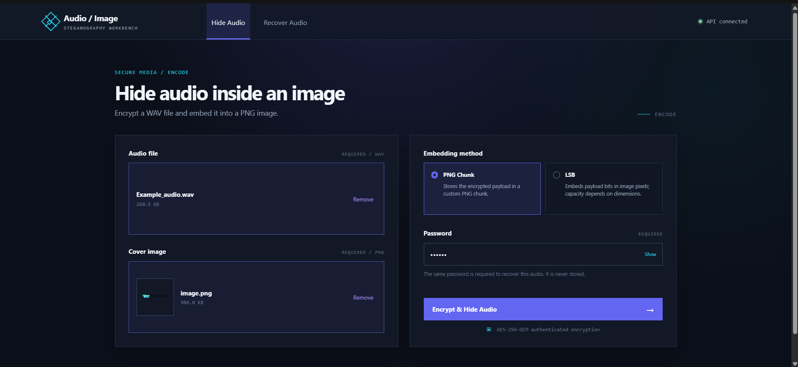
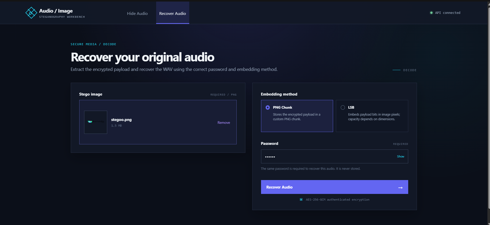
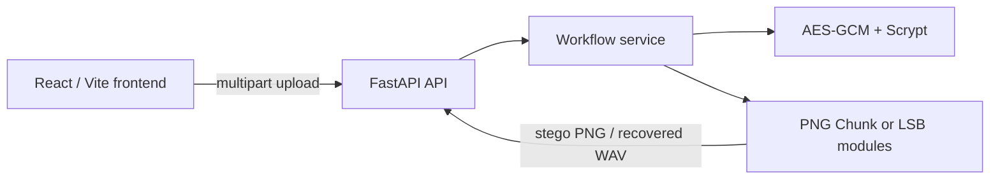

# Audio / Image Steganography

🌐 **Live Demo:** [Try it here](https://audio-image-steganography.vercel.app/)

Audio / Image Steganography is a full-stack application for encrypting a WAV
file and hiding the encrypted payload inside a PNG image. Combining
authenticated encryption with steganography protects the audio contents while
providing a practical image-based carrier; recovery still requires the correct
password and embedding method.

The project is a working technical utility, not a claim of undetectable
steganography. Image transformations and steganalysis can affect or reveal
embedded data.

## Screenshots

### Hide Audio

<p>
  
</p>

### Recover Audio

<p>
  
</p>

## Features

- Encrypts and recovers uncompressed PCM WAV audio.
- Uses AES-256-GCM authenticated encryption with Scrypt password-based key
  derivation. Incorrect passwords and tampered encrypted data fail
  authentication.
- Supports two embedding methods:
  - **PNG Chunk:** stores the encrypted envelope in a custom `stEg` ancillary
    PNG chunk.
  - **LSB:** embeds the encrypted envelope into RGB pixel least-significant
    bits.
- Validates PNG structure, image format, WAV content, payload boundaries, PNG
  CRCs, and LSB payload checksums.
- Provides image-quality measurements for RGB/RGBA images, including changed
  channel counts, channel ratios, mean squared error (MSE), and peak
  signal-to-noise ratio (PSNR).
- Includes a React/Vite interface with drag-and-drop file selection, PNG
  preview, method selection, password visibility controls, API status,
  validation and API error feedback, loading states, downloadable outputs, and
  a subtle footer linking to the creator's GitHub profile.
- Provides FastAPI endpoints for health checks, hiding, and recovery.
- Limits each uploaded WAV and PNG file to 20 MiB by default and reads uploads
  incrementally before workflow processing.

## How it works

1. Select a WAV file and a PNG cover image.
2. Choose **PNG Chunk** or **LSB**.
3. Enter a password.
4. The backend validates the inputs, encrypts the WAV, and embeds the
   authenticated envelope in the PNG.
5. Download the resulting stego PNG.
6. Upload that PNG later with the same password and embedding method to recover
   the WAV.



## Embedding methods

| Method | Storage model | Practical considerations |
| --- | --- | --- |
| PNG Chunk | Stores the encrypted payload in a custom `stEg` chunk immediately before `IEND`. | Preserves decoded pixels and has direct byte capacity, but services that strip unknown ancillary chunks can remove the payload. |
| LSB | Stores payload bits in RGB pixel channels; alpha is not modified. | Capacity depends on image dimensions and encrypted payload size. Resizing, recompression, or re-encoding can damage the payload. |

Neither method guarantees that hidden data is undetectable or resistant to
steganalysis. The encrypted envelope remains the security boundary for
confidentiality and tamper detection.

## Technology stack

### Frontend

- React 19
- Vite
- Plain CSS with the Nebula Core dark workbench theme

### Backend and API

- Python 3.13 (currently tested environment)
- FastAPI
- Uvicorn
- `python-multipart` for multipart form handling

### Cryptography

- `cryptography`
- AES-GCM
- Scrypt

### Image processing

- Pillow for PNG decoding, RGB/RGBA LSB operations, and image metrics
- Custom byte-level PNG chunk parsing for `stEg` payloads

### Testing

- pytest
- HTTPX/FastAPI `TestClient` support

## Project structure

```text
.
├── backend/
│   ├── app/
│   │   ├── main.py                 # FastAPI application and API routes
│   │   ├── core/
│   │   │   ├── crypto.py           # AES-GCM and Scrypt
│   │   │   ├── envelope.py         # Versioned encrypted envelope
│   │   │   └── validation.py       # Shared input validation
│   │   ├── services/
│   │   │   └── workflow.py         # End-to-end WAV workflows
│   │   ├── stego/
│   │   │   ├── png_chunk.py        # PNG stEg chunk embedding
│   │   │   └── lsb.py              # RGB/RGBA LSB embedding
│   │   └── utils/
│   │       ├── hashing.py          # SHA-256 helpers
│   │       └── image_metrics.py    # MSE, PSNR, and channel metrics
│   ├── tests/
│   │   ├── test_api.py
│   │   ├── test_crypto.py
│   │   ├── test_lsb.py
│   │   ├── test_png_chunk.py
│   │   └── test_workflow.py
│   ├── README.md
│   └── requirements.txt
├── frontend/
│   ├── src/
│   │   ├── App.jsx                 # Hide/recover workbench UI
│   │   ├── api.js                  # FastAPI client and error handling
│   │   ├── main.jsx                # React entry point
│   │   └── styles.css              # Nebula Core visual system
│   ├── index.html
│   ├── package.json
│   ├── package-lock.json
│   └── vite.config.js              # Vite config and /api proxy
├── .github/
│   └── copilot-instructions.md
└── README.md
```

Generated directories such as `frontend/node_modules`, `frontend/dist`,
Python virtual environments, bytecode caches, and test caches are omitted from
the structure above.

## Setup and running locally

### Backend

From the repository root in Windows PowerShell:

```powershell
python -m venv backend\.venv
.\backend\.venv\Scripts\python.exe -m pip install -r backend\requirements.txt
.\backend\.venv\Scripts\python.exe -m uvicorn backend.app.main:app --reload
```

The API listens on the Uvicorn default `http://127.0.0.1:8000`. FastAPI's
interactive documentation is available at
`http://127.0.0.1:8000/docs`.

The API accepts browser requests from the deployed frontend
(`https://audio-image-steganography.vercel.app`) and the Vite development
origins `http://localhost:5173` and `http://127.0.0.1:5173`. CORS is limited
to the API's GET, POST, and OPTIONS methods and the request headers used by the
frontend; other origins are not permitted.

### Frontend

Open a second PowerShell terminal:

```powershell
cd frontend
npm install
npm run dev
```

Vite serves the frontend at its default URL,
`http://localhost:5173`. The Vite development server proxies relative `/api`
requests to `http://127.0.0.1:8000`.

For deployments or a different backend location, set `VITE_API_BASE_URL` in
`frontend\.env`:

```text
VITE_API_BASE_URL=https://example.invalid
```

When set, the frontend uses that absolute base URL directly instead of the
Vite development proxy. Do not put passwords in environment variables,
browser storage, URLs, or logs.

## API reference

All file endpoints use `multipart/form-data`. The accepted embedding methods
are `chunk` and `lsb`.

### `GET /api/health`

Returns HTTP `200` with:

```json
{"status": "ok"}
```

### `POST /api/hide`

Multipart fields:

| Field | Type | Description |
| --- | --- | --- |
| `wav` | file | Non-empty, uncompressed PCM WAV input. Maximum 20 MiB. |
| `image` | file | Valid PNG cover image. Maximum 20 MiB. |
| `password` | text | Password used for AES-GCM encryption. |
| `method` | text | `chunk` or `lsb`. |

Returns HTTP `200` with `image/png` and a downloadable `stego.png`.

### `POST /api/recover`

Multipart fields:

| Field | Type | Description |
| --- | --- | --- |
| `image` | file | PNG containing the encrypted payload. Maximum 20 MiB. |
| `password` | text | Password used for authenticated decryption. |
| `method` | text | The same method used during hiding: `chunk` or `lsb`. |

Returns HTTP `200` with `audio/wav` and a downloadable `recovered.wav`.

### Error responses

- `400 Bad Request`: invalid WAV/PNG data, malformed payloads, unsupported
  workflow inputs, insufficient LSB capacity, or other workflow validation
  failures.
- `401 Unauthorized`: incorrect password or authenticated payload failure.
- `413 Payload Too Large`: a WAV or PNG upload exceeds its 20 MiB limit.
- `422 Unprocessable Entity`: required multipart fields are missing or the
  `method` value is not one of the accepted literals.

The API returns controlled error messages and does not expose stack traces.

## Testing

Run the backend tests from the repository root:

```powershell
python -m pytest backend\tests -q
```

Build the frontend production bundle:

```powershell
cd frontend
npm run build
```

The last verified results were **45 passing backend tests** and a successful
frontend production build. These are recorded results, not a guarantee for
future changes.

## Security notes and limitations

- AES-256-GCM authentication rejects incorrect passwords and tampered
  encrypted data. PNG CRC-32 and the LSB checksum detect structural or
  accidental corruption but are not substitutes for authenticated encryption.
- Recovery requires the same embedding method used during hiding.
- LSB capacity is limited by image dimensions and the size of the encrypted
  envelope.
- Resizing, recompression, re-encoding, conversion, or image services that
  remove ancillary chunks can destroy hidden data.
- The project does not guarantee that embedded data is undetectable or
  resistant to steganalysis.
- Users must retain the password; it is not stored in the PNG or by the
  application.
- Uploads are read and processed in memory. Before exposing the API to
  untrusted users, deploy it with appropriate resource limits, access
  controls, monitoring, and HTTPS.

## Future improvements

- Add frontend behavior tests.
- Add production deployment guidance, including a hardened reverse proxy and
  operational resource controls.
- Add optional capacity and image-quality information to the user interface
  before an LSB operation.